# Database Model

The schema is defined with Drizzle ORM in [`src/db/schema`](../src/db/schema) and
targets PostgreSQL. `src/db/schema/index.ts` is the entry point used by
`drizzle-kit`, so any new table must be exported there to be part of the
database.

## Entity-relationship diagram

```mermaid
erDiagram
    %% Authentication (Better Auth)
    USER o|--o| STUDENT : "has profile"
    USER o|--o| PROFESSIONAL : "has profile"
    USER ||--o{ SESSION : "authenticates"
    USER ||--o{ ACCOUNT : "owns"

    %% Memberships and billing
    STUDENT ||--o{ MEMBERSHIP : "subscribes"
    PLAN ||--o{ MEMBERSHIP : "defines"
    MEMBERSHIP ||--o{ PAYMENT : "generates"
    PLAN ||--o{ PLAN_FEATURE : "offers"
    FEATURE ||--o{ PLAN_FEATURE : "included in"

    %% Staff/student assignment
    PROFESSIONAL ||--o{ PROFESSIONAL_STUDENT : "mentors"
    STUDENT ||--o{ PROFESSIONAL_STUDENT : "is mentored by"

    %% Workouts
    STUDENT ||--o{ WORKOUT : "is assigned"
    PROFESSIONAL o|--o{ WORKOUT : "prescribes"
    WORKOUT ||--o{ WORKOUT_ITEM : "contains"
    EXERCISE ||--o{ WORKOUT_ITEM : "used in"
    STUDENT ||--o{ WORKOUT_REQUEST : "requests"
    STUDENT ||--o{ WORKOUT_SESSION : "performs"
    WORKOUT ||--o{ WORKOUT_SESSION : "is executed as"
    WORKOUT_SESSION ||--o{ WORKOUT_SESSION_SET : "records"
    EXERCISE ||--o{ WORKOUT_SESSION_SET : "logged in"

    %% Exercise library
    EXERCISE ||--o{ EXERCISE_MUSCLE : "targets"
    MUSCLE ||--o{ EXERCISE_MUSCLE : "is targeted by"

    %% Classes
    CLASSES ||--o{ CLASS_SCHEDULE : "is scheduled as"
    PROFESSIONAL ||--o{ CLASS_SCHEDULE : "instructs"
    CLASS_SCHEDULE ||--o{ CLASS_ATTENDANCE : "registers"
    STUDENT ||--o{ CLASS_ATTENDANCE : "attends"

    USER {
        text id PK
        text name
        text email "unique"
        boolean email_verified
        text image
        user_role role "enum: student, professional, admin"
        timestamp created_at
        timestamp updated_at
    }

    SESSION {
        text id PK
        timestamp expires_at
        text token "unique"
        timestamp created_at
        timestamp updated_at
        text ip_address
        text user_agent
        text user_id FK
    }

    ACCOUNT {
        text id PK
        text account_id
        text provider_id
        text user_id FK
        text access_token
        text refresh_token
        text id_token
        timestamp access_token_expires_at
        timestamp refresh_token_expires_at
        text scope
        text password
        timestamp created_at
        timestamp updated_at
    }

    VERIFICATION {
        text id PK
        text identifier
        text value
        timestamp expires_at
        timestamp created_at
        timestamp updated_at
    }

    STUDENT {
        uuid id PK
        text user_id FK "unique"
        varchar cpf "unique, 11"
        varchar phone "20"
        status status "enum: active, suspended, cancelled"
        timestamp created_at
    }

    PROFESSIONAL {
        uuid id PK
        text user_id FK "unique"
        varchar cref "20"
        text specialty
        boolean approved "default false"
    }

    PROFESSIONAL_STUDENT {
        uuid professional_id PK, FK
        uuid student_id PK, FK
        timestamp created_at
    }

    PLAN {
        uuid id PK
        varchar name "100"
        billing_cycle billing_cycle "enum: mensal, quarterly, semiannual, annual"
        numeric base_price "12,2"
        timestamp created_at
        timestamp updated_at
    }

    FEATURE {
        uuid id PK
        varchar name "150"
        text description
    }

    PLAN_FEATURE {
        uuid plan_id PK, FK
        uuid feature_id PK, FK
        boolean included "default true"
    }

    MEMBERSHIP {
        uuid id PK
        uuid student_id FK
        uuid plan_id FK
        date start_date
        date end_date
        numeric applied_discount "10,2, default 0.00"
        membership_status status "enum: pending, active, frozen, expired, canceled, suspended"
        text contract_url
    }

    PAYMENT {
        uuid id PK
        uuid membership_id FK
        numeric amount "10,2"
        date due_date
        date payment_date
        payment_status status "enum: pending, completed, overdue"
    }

    EXPENSE_BILL {
        uuid id PK
        expense_category category "enum"
        text description
        numeric amount "12,2"
        date due_date
        date payment_date
        varchar type "100"
    }

    EXERCISE {
        uuid id PK
        varchar name "100"
    }

    MUSCLE {
        uuid id PK
        text name
        text slug "unique"
        text body_group
    }

    EXERCISE_MUSCLE {
        uuid exercise_id PK, FK
        uuid muscle_id PK, FK
        real stimulus_strength
    }

    WORKOUT {
        uuid id PK
        uuid student_id FK
        uuid prescribed_by_professional_id FK "nullable"
        varchar title "50"
        date start_date
        date end_date "nullable"
    }

    WORKOUT_ITEM {
        uuid id PK
        uuid workout_id FK
        uuid exercise_id FK
        int position "default 0"
        int sets
        int reps
        int rest_seconds "default 30"
    }

    WORKOUT_REQUEST {
        uuid id PK
        uuid student_id FK
        experience_level experience_level "enum: beginner, intermediate, advanced"
        text priorities
        text focused_muscles
        boolean has_injuries "default false"
        text injury_details "nullable"
        boolean solved "default false"
        timestamp created_at
    }

    WORKOUT_SESSION {
        uuid id PK
        uuid student_id FK
        uuid workout_id FK
        session_status status "enum: in_progress, completed, abandoned"
        timestamp started_at
        timestamp completed_at "nullable"
    }

    WORKOUT_SESSION_SET {
        uuid id PK
        uuid session_id FK
        uuid exercise_id FK
        int set_number
        int target_reps
        int actual_reps "nullable"
        numeric actual_weight "6,2, nullable"
        boolean completed "default false"
    }

    CLASSES {
        uuid id PK
        varchar name "100"
        int capacity
    }

    CLASS_SCHEDULE {
        uuid id PK
        uuid class_id FK
        uuid professional_id FK
        time start_time
        time end_time
        day_of_week day_week "enum: monday..sunday"
    }

    CLASS_ATTENDANCE {
        uuid id PK
        uuid schedule_id FK
        uuid student_id FK
        timestamp attended_at "default now"
    }
```

## Enumerated types

Enums are declared in PostgreSQL and reused by the table columns shown above.

| PostgreSQL type | Declared in | Values |
| --- | --- | --- |
| `status` | `enums.ts` | `active`, `suspended`, `cancelled` |
| `billing_cycle` | `enums.ts` | `mensal`, `quarterly`, `semiannual`, `annual` |
| `membership_status` | `enums.ts` | `pending`, `active`, `frozen`, `expired`, `canceled`, `suspended` |
| `expense_category` | `enums.ts` | `salary`, `machinery`, `repair`, `cleaning`, `monthly`, `supplies`, `rent`, `loans` |
| `day_of_week` | `enums.ts` | `monday`, `tuesday`, `wednesday`, `thursday`, `friday`, `saturday`, `sunday` |
| `payment_status` | `enums.ts` | `pending`, `completed`, `overdue` |
| `user_role` | `enums.ts` | `student`, `professional`, `admin` |
| `experience_level` | `workout-requests.ts` | `beginner`, `intermediate`, `advanced` |
| `session_status` | `workout_sessions.ts` | `in_progress`, `completed`, `abandoned` |

## Integrity rules

- **One live membership per student.** `memberships_one_live_per_student` is a
  partial unique index on `memberships.student_id` restricted to rows whose
  `status` is `pending` or `active`. Historical memberships remain unrestricted.
- **Profile linkage.** `students.user_id` and `professionals.user_id` are unique
  and reference `user.id`. Deleting a user cascades to both profile tables.
- **Deletion behaviour.**
  - Cascade: `user` → `session`, `account`, `students`, `professionals`;
    `student` → `memberships`, `professional_students`, `workouts`,
    `workout_requests`, `workout_sessions`, `class_attendances`;
    `workout` → `workout_items`, `workout_sessions`;
    `workout_session` → `workout_session_sets`;
    `class` → `class_schedules`; `class_schedule` → `class_attendances`;
    `professional` → `class_schedules`; `plan`/`feature` → `plan_features`;
    `exercise`/`muscle` → `exercise_muscles`.
  - Restrict: `memberships.plan_id` blocks deleting a plan in use,
    `payments.membership_id` blocks deleting a membership with payments, and
    `workout_items.exercise_id` blocks deleting an exercise in use.
  - Set null: `workouts.prescribed_by_professional_id` keeps the workout when
    the prescribing professional is removed.
  - No action: `workout_session_sets.exercise_id` has no explicit rule, so an
    exercise referenced by logged sets cannot be deleted.
- **Composite primary keys.** `professional_students` (`professional_id`,
  `student_id`), `plan_features` (`plan_id`, `feature_id`), and
  `exercise_muscles` (`exercise_id`, `muscle_id`) model many-to-many
  relationships without surrogate IDs.
- **Identifier types.** Better Auth tables use `text` IDs generated by the auth
  library. Application tables use UUID primary keys (`gen_random_uuid()`).
- **Timestamps.** Application tables that expose `created_at` default it to
  `now()`; Better Auth tables receive their timestamps from the auth library.
  `plans.updated_at` refreshes on update via Drizzle's `$onUpdate`.

## Notes

- `expense_bills` is currently standalone: it has no foreign key to an admin or
  user, so the responsible party is not recorded in the schema.
- `account.password` stores the credential hash for email/password sign-in.
- `verification` is keyed by `identifier` (for example an email address) rather
  than linking to `user`, matching Better Auth's contract.
- `workout_session_sets.exercise_id` has no `onDelete` rule, so the default
  (`no action`) applies and an exercise in use cannot be removed.
